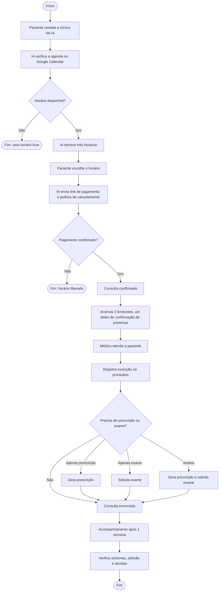
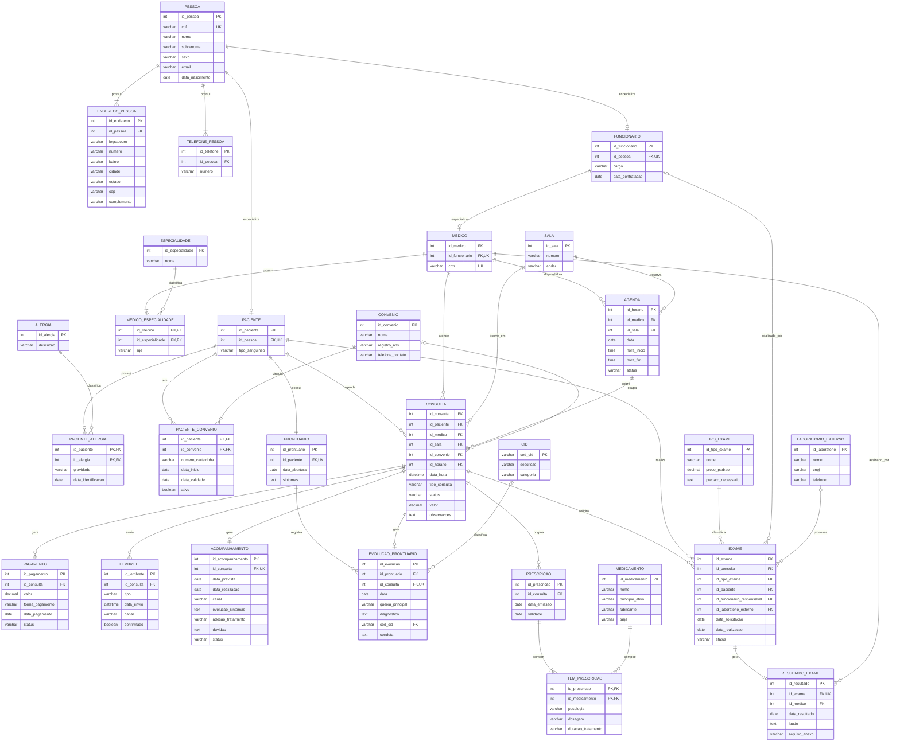

# Sistema de Gestão Clínica — Centro de Ginecologia Natural e Emocional

Projeto de **modelagem de banco de dados** para uma clínica de saúde da mulher. O modelo organiza em um único banco o cadastro de pacientes e profissionais, a agenda, as consultas, os pagamentos, o prontuário eletrônico, as prescrições e os exames. Hoje essas informações ficam espalhadas entre a IA de agendamento, o Google Calendar, o sistema de pagamento e anotações do profissional.

> Trabalho desenvolvido pelo **Grupo 3** na disciplina de **Modelagem de Dados**.

---

## Sumário

1. [Contexto do negócio](#1-contexto-do-negócio)
2. [Processo atual](#2-processo-atual)
3. [Problemas identificados](#3-problemas-identificados)
4. [Requisitos funcionais](#4-requisitos-funcionais)
5. [Requisitos não funcionais](#5-requisitos-não-funcionais)
6. [Regras de negócio](#6-regras-de-negócio)
7. [Aprovações e permissões](#7-aprovações-e-permissões)
8. [Modelo de dados](#8-modelo-de-dados)
9. [Decisões de modelagem](#9-decisões-de-modelagem)
10. [Pendências e próximos passos](#10-pendências-e-próximos-passos)
11. [Estrutura do repositório](#11-estrutura-do-repositório)
12. [Mapa das etapas da disciplina](#12-mapa-das-etapas-da-disciplina)

---

## 1. Contexto do negócio

| Item | Descrição |
|---|---|
| **Empresa** | Centro de Ginecologia Natural e Emocional |
| **Segmento** | Saúde da mulher — ginecologia natural e integrativa |
| **Oferta** | Consultas e tratamentos naturais para sintomas e diagnósticos ginecológicos |
| **Público principal** | Mulheres de 30 a 55 anos com SOP (síndrome dos ovários policísticos), endometriose, mioma, candidíase ou sintomas de perimenopausa |
| **Motivo da escolha** | A clínica pertence a uma pessoa próxima de um integrante do grupo, o que facilita o levantamento de requisitos |

### Informações estratégicas para a clínica

- Queixa principal e diagnóstico da paciente
- Perfil da paciente e histórico de tratamentos
- Taxa de comparecimento
- Taxa de remarcação

---

## 2. Processo atual

O agendamento e os lembretes já são automatizados por uma **IA de atendimento** sincronizada ao Google Calendar. Apenas o acompanhamento pós-consulta é manual.

```text
Paciente → Agendamento (IA) → Pagamento → Lembretes → Consulta → Acompanhamento (1 semana)
```

| Etapa | Participantes | Gatilho | O que acontece | Informação gerada | Resultado |
|---|---|---|---|---|---|
| **Agendamento** | Paciente e IA | Paciente pede uma consulta | A IA consulta o Google Calendar e oferece 3 horários livres | Data, horário e dados da paciente | Consulta marcada |
| **Pagamento** | Paciente e sistema de pagamento | Escolha do horário | A IA envia o link de pagamento e a política de cancelamento | Registro do pagamento | Consulta paga e confirmada |
| **Lembretes** | IA e paciente | Proximidade da consulta | São enviados 3 lembretes, sendo um deles de confirmação de presença | Presença confirmada ou não | Paciente ciente da consulta |
| **Consulta** | Paciente e profissional | Horário marcado | Atendimento clínico | Queixas, avaliação e plano de tratamento | Orientações ou protocolo definidos |
| **Acompanhamento** | Profissional e paciente | 1 semana após a consulta | Contato presencial ou por telefone | Evolução, adesão ao tratamento e dúvidas | Tratamento acompanhado e ajustado |

### Fluxograma

O fluxograma completo está em [`Fluxograma.drawio.xml`](Fluxograma.drawio.xml). Resumo:



---

## 3. Problemas identificados

| # | Problema | Consequência |
|---|---|---|
| 1 | Acompanhamento pós-consulta feito manualmente | Depende de o profissional lembrar; pode atrasar ou não acontecer |
| 2 | Não há prontuário eletrônico integrado | Dados clínicos ficam dispersos e podem se perder |
| 3 | Não há relatórios de agendamentos, faltas e cancelamentos | Difícil acompanhar o desempenho da clínica |
| 4 | Pagamento e agendamento em sistemas separados | Risco de o pagamento não ficar vinculado à consulta |

O modelo proposto responde a cada um deles:

| # | Como o modelo resolve |
|---|---|
| 1 | `ACOMPANHAMENTO` registra a data prevista, a realização e o resultado de cada acompanhamento, permitindo cobrar os pendentes |
| 2 | `PRONTUARIO` e `EVOLUCAO_PRONTUARIO` centralizam o histórico clínico da paciente |
| 3 | Os status de `CONSULTA` (incluindo `falta` e `remarcada`) e a tabela `LEMBRETE` permitem calcular comparecimento, faltas e remarcações |
| 4 | `PAGAMENTO` fica vinculado à `CONSULTA` que o originou |

---

## 4. Requisitos funcionais

Cada requisito recebe um código (RF) para rastreabilidade, no mesmo formato das regras de negócio.

### Cadastros

| Código | Área | Requisito |
|---|---|---|
| RF01 | Pessoas | Cadastrar pessoa com nome, sobrenome, CPF, e-mail, data de nascimento, endereços e telefones. |
| RF02 | Pacientes | Cadastrar paciente vinculado a uma pessoa, com tipo sanguíneo. |
| RF03 | Funcionários | Cadastrar funcionário vinculado a uma pessoa, com cargo e data de contratação. |
| RF04 | Médicos | Cadastrar médico vinculado a um funcionário, com CRM. |
| RF05 | Especialidades | Cadastrar especialidade e registrar o RQE do médico em cada uma delas. |
| RF06 | Salas | Cadastrar sala com número e andar. |
| RF07 | Convênios | Cadastrar convênio com nome, registro na ANS e telefone. |
| RF08 | Alergias | Cadastrar alergia com descrição e registrar, por paciente, a gravidade e a data de identificação. |
| RF09 | Medicamentos | Cadastrar medicamento com nome, princípio ativo, fabricante e tarja. |
| RF10 | Tipos de exame | Cadastrar tipo de exame com nome, preço padrão e preparo necessário. |
| RF11 | Laboratórios externos | Cadastrar laboratório externo com nome, CNPJ e telefone. |
| RF12 | CID | Cadastrar CID com código, descrição e categoria. |

### Operações

| Código | Área | Requisito |
|---|---|---|
| RF13 | Convênios | Vincular a paciente a um ou mais convênios, com número da carteirinha, data de início e validade. |
| RF14 | Agenda | Gerenciar os horários de cada médico (data, início, fim, sala e status) e consultar os horários livres. |
| RF15 | Consultas | Marcar consulta vinculando paciente, médico, sala, horário da agenda e, se houver, convênio, com data/hora, tipo e status. |
| RF16 | Lembretes | Registrar cada lembrete enviado pela IA (tipo, data e canal) e a confirmação de presença da paciente. |
| RF17 | Acompanhamento | Agendar o acompanhamento 1 semana após a consulta e registrar canal, evolução dos sintomas, adesão ao tratamento e dúvidas. |
| RF18 | Pagamentos | Registrar valor, forma, data e status do pagamento de cada consulta. |
| RF19 | Prontuário | Abrir um prontuário por paciente e registrar uma evolução a cada consulta (queixa principal, diagnóstico, CID e conduta). |
| RF20 | Prescrições | Emitir prescrições vinculadas à consulta, com medicamento, posologia, dosagem e duração de cada item. |
| RF21 | Exames | Solicitar exames vinculados à consulta e à paciente, acompanhar datas e status, indicar o laboratório externo e registrar o resultado (laudo, anexo e médico responsável). |

---

## 5. Requisitos não funcionais

| Código | Categoria | Requisito |
|---|---|---|
| RNF01 | Segurança | Controlar o acesso por perfil (médico, funcionário e paciente). |
| RNF02 | Segurança | Proteger o prontuário e as prescrições. |
| RNF03 | Segurança | Registrar auditoria de quem alterou o quê e quando. |
| RNF04 | Privacidade (LGPD) | Tratar dados sensíveis de saúde conforme a LGPD. |
| RNF05 | Privacidade (LGPD) | Permitir que a paciente solicite os próprios dados. |
| RNF06 | Desempenho | Disponibilizar o histórico da paciente em tempo adequado durante o atendimento. |
| RNF07 | Desempenho | Garantir agendamento sem demora perceptível. |
| RNF08 | Disponibilidade | Manter o agendamento disponível 24 horas. |
| RNF09 | Disponibilidade | Realizar backup periódico para evitar perda do prontuário. |
| RNF10 | Usabilidade | Oferecer interface simples para o profissional durante a consulta. |
| RNF11 | Usabilidade | Garantir interação fácil com a IA de agendamento. |
| RNF12 | Confiabilidade | Manter a agenda sempre sincronizada com o Google Calendar. |
| RNF13 | Confiabilidade | Impedir duplicidade de horários. |
| RNF14 | Confiabilidade | Confirmar a consulta somente após o pagamento ou a confirmação do convênio (ver RN13). |
| RNF15 | Integração | Integrar com o Google Calendar para a agenda dos médicos. |
| RNF16 | Integração | Integrar com o sistema de pagamento para geração e envio automático de links. |

---

## 6. Regras de negócio

| Código | Área | Regra |
|---|---|---|
| RN01 | Pessoas | Toda pessoa deve possuir CPF único. |
| RN02 | Pessoas | Cada paciente e cada funcionário correspondem a exatamente uma pessoa. |
| RN03 | Pessoas | Todo médico é um funcionário e deve possuir CRM válido e único. |
| RN04 | Pessoas | Um médico possui uma ou mais especialidades. |
| RN05 | Convênios | Uma paciente pode possuir vários convênios, cada um com data de validade. |
| RN06 | Convênios | A clínica só aceita convênios cadastrados, e o uso depende da validade da carteirinha. |
| RN07 | Convênios | Uma consulta pode ou não estar vinculada a um convênio (atendimento particular). |
| RN08 | Alergias | Uma paciente pode possuir várias alergias, cada uma com grau de gravidade. |
| RN09 | Agendamento | Toda consulta deve estar associada a uma paciente, a um médico e a uma sala disponível. |
| RN10 | Agendamento | Um médico não pode ter duas consultas no mesmo horário. |
| RN11 | Agendamento | A IA oferece 3 horários livres (ou todos os disponíveis, se houver menos de 3). |
| RN12 | Agendamento | Um horário só é considerado ocupado após a confirmação do agendamento. |
| RN13 | Pagamento | A consulta só é confirmada após o pagamento ou a confirmação do convênio. |
| RN14 | Pagamento | O status do pagamento é atualizado conforme a confirmação. |
| RN15 | Lembretes | A paciente recebe 3 lembretes antes da consulta, sendo um deles de confirmação de presença. |
| RN16 | Cancelamento | O cancelamento segue a política da clínica (prazo mínimo e reembolso); fora do prazo pode gerar cobrança. |
| RN17 | Prontuário | Toda paciente possui exatamente um prontuário. |
| RN18 | Prontuário | Toda consulta realizada gera uma evolução no prontuário. |
| RN19 | Prescrição | Toda prescrição está vinculada a uma consulta e contém pelo menos um item. |
| RN20 | Prescrição | Todo item de prescrição possui posologia e dosagem definidas. |
| RN21 | Exames | Todo exame está vinculado a uma consulta e a uma paciente, e pode ser processado por um laboratório externo. |
| RN22 | Exames | Todo exame realizado gera um resultado assinado por um médico. |
| RN23 | Acompanhamento | Toda consulta gera um acompanhamento 1 semana depois, para verificar sintomas e adesão ao tratamento. |

---

## 7. Aprovações e permissões

| Área | Quem pode | Observação |
|---|---|---|
| Prontuário | Somente o médico responsável altera | Acesso restrito à equipe médica |
| Dados cadastrais | Somente funcionários autorizados alteram | — |
| Dados financeiros | Somente a administração da clínica acessa | — |
| Acompanhamento | O profissional que atendeu confirma a realização | Prazo padrão de 1 semana |
| Dados próprios | A paciente acessa apenas os próprios dados | Direito garantido pela LGPD |

---

## 8. Modelo de dados

O modelo possui **28 entidades**. O dicionário completo (tipos, tamanhos, nulidade e descrições) está em [`Dicionario_de_Dados_Clinica.xlsx`](Dicionario_de_Dados_Clinica.xlsx).

### 8.1 Entidades

| Grupo | Entidades |
|---|---|
| **Pessoas** | `PESSOA`, `ENDERECO_PESSOA`, `TELEFONE_PESSOA`, `PACIENTE`, `FUNCIONARIO`, `MEDICO` |
| **Qualificação médica** | `ESPECIALIDADE`, `MEDICO_ESPECIALIDADE` |
| **Saúde da paciente** | `ALERGIA`, `PACIENTE_ALERGIA` |
| **Convênios** | `CONVENIO`, `PACIENTE_CONVENIO` |
| **Agenda e atendimento** | `SALA`, `AGENDA`, `CONSULTA`, `PAGAMENTO` |
| **Acompanhamento** | `LEMBRETE`, `ACOMPANHAMENTO` |
| **Prontuário** | `PRONTUARIO`, `EVOLUCAO_PRONTUARIO`, `CID` |
| **Prescrição** | `MEDICAMENTO`, `PRESCRICAO`, `ITEM_PRESCRICAO` |
| **Exames** | `TIPO_EXAME`, `LABORATORIO_EXTERNO`, `EXAME`, `RESULTADO_EXAME` |

### 8.2 Diagrama entidade-relacionamento



> O diagrama editável está em [`Diagrama clínica.drawio`](Diagrama%20cl%C3%ADnica.drawio) e pode ser aberto no [diagrams.net](https://app.diagrams.net).

### 8.3 Relacionamentos e cardinalidades

Notação: `(mín, máx)` de cada lado, lida a partir da entidade indicada.

| Entidade A | Cardinalidade A | Relacionamento | Cardinalidade B | Entidade B | FK |
|---|---|---|---|---|---|
| PESSOA | (1,1) | possui | (1,N) | ENDERECO_PESSOA | `ENDERECO_PESSOA.id_pessoa` |
| PESSOA | (1,1) | possui | (1,N) | TELEFONE_PESSOA | `TELEFONE_PESSOA.id_pessoa` |
| PESSOA | (1,1) | especializa | (0,1) | PACIENTE | `PACIENTE.id_pessoa` |
| PESSOA | (1,1) | especializa | (0,1) | FUNCIONARIO | `FUNCIONARIO.id_pessoa` |
| FUNCIONARIO | (1,1) | especializa | (0,1) | MEDICO | `MEDICO.id_funcionario` |
| MEDICO | (1,1) | possui | (1,N) | MEDICO_ESPECIALIDADE | `MEDICO_ESPECIALIDADE.id_medico` |
| ESPECIALIDADE | (1,1) | classifica | (0,N) | MEDICO_ESPECIALIDADE | `MEDICO_ESPECIALIDADE.id_especialidade` |
| PACIENTE | (1,1) | possui | (0,N) | PACIENTE_ALERGIA | `PACIENTE_ALERGIA.id_paciente` |
| ALERGIA | (1,1) | classifica | (0,N) | PACIENTE_ALERGIA | `PACIENTE_ALERGIA.id_alergia` |
| PACIENTE | (1,1) | tem | (0,N) | PACIENTE_CONVENIO | `PACIENTE_CONVENIO.id_paciente` |
| CONVENIO | (1,1) | vincula | (0,N) | PACIENTE_CONVENIO | `PACIENTE_CONVENIO.id_convenio` |
| MEDICO | (1,1) | disponibiliza | (0,N) | AGENDA | `AGENDA.id_medico` |
| SALA | (1,1) | reserva | (0,N) | AGENDA | `AGENDA.id_sala` |
| PACIENTE | (1,1) | agenda | (0,N) | CONSULTA | `CONSULTA.id_paciente` |
| MEDICO | (1,1) | atende | (0,N) | CONSULTA | `CONSULTA.id_medico` |
| SALA | (1,1) | ocorre em | (0,N) | CONSULTA | `CONSULTA.id_sala` |
| AGENDA | (1,1) | ocupa | (0,N) | CONSULTA | `CONSULTA.id_horario` |
| CONVENIO | (0,1) | cobre | (0,N) | CONSULTA | `CONSULTA.id_convenio` (opcional) |
| CONSULTA | (1,1) | gera | (0,N) | PAGAMENTO | `PAGAMENTO.id_consulta` |
| CONSULTA | (1,1) | envia | (0,N) | LEMBRETE | `LEMBRETE.id_consulta` |
| CONSULTA | (1,1) | gera | (0,1) | ACOMPANHAMENTO | `ACOMPANHAMENTO.id_consulta` (único) |
| PACIENTE | (1,1) | possui | (1,1) | PRONTUARIO | `PRONTUARIO.id_paciente` (único) |
| PRONTUARIO | (1,1) | registra | (0,N) | EVOLUCAO_PRONTUARIO | `EVOLUCAO_PRONTUARIO.id_prontuario` |
| CONSULTA | (1,1) | gera | (0,1) | EVOLUCAO_PRONTUARIO | `EVOLUCAO_PRONTUARIO.id_consulta` |
| CID | (0,1) | classifica | (0,N) | EVOLUCAO_PRONTUARIO | `EVOLUCAO_PRONTUARIO.cod_cid` (opcional) |
| CONSULTA | (1,1) | origina | (0,N) | PRESCRICAO | `PRESCRICAO.id_consulta` |
| PRESCRICAO | (1,1) | contém | (1,N) | ITEM_PRESCRICAO | `ITEM_PRESCRICAO.id_prescricao` |
| MEDICAMENTO | (1,1) | compõe | (0,N) | ITEM_PRESCRICAO | `ITEM_PRESCRICAO.id_medicamento` |
| CONSULTA | (1,1) | solicita | (0,N) | EXAME | `EXAME.id_consulta` |
| PACIENTE | (1,1) | realiza | (0,N) | EXAME | `EXAME.id_paciente` |
| TIPO_EXAME | (1,1) | classifica | (0,N) | EXAME | `EXAME.id_tipo_exame` |
| FUNCIONARIO | (0,1) | realizado por | (0,N) | EXAME | `EXAME.id_funcionario_responsavel` (opcional) |
| LABORATORIO_EXTERNO | (0,1) | processa | (0,N) | EXAME | `EXAME.id_laboratorio_externo` (opcional) |
| EXAME | (1,1) | gera | (0,1) | RESULTADO_EXAME | `RESULTADO_EXAME.id_exame` |
| MEDICO | (1,1) | assinado por | (0,N) | RESULTADO_EXAME | `RESULTADO_EXAME.id_medico` |

### 8.4 Relacionamentos N:N e entidades associativas

O modelo possui **quatro** relacionamentos N:N, todos resolvidos por entidades associativas com **chave primária composta**:

| Relacionamento N:N | Entidade associativa | PK composta | Atributos próprios | Justificativa |
|---|---|---|---|---|
| MEDICO ↔ ESPECIALIDADE | `MEDICO_ESPECIALIDADE` | `id_medico` + `id_especialidade` | `rqe` | O RQE é o registro do médico **naquela** especialidade; não pertence só ao médico nem só à especialidade. |
| PACIENTE ↔ ALERGIA | `PACIENTE_ALERGIA` | `id_paciente` + `id_alergia` | `gravidade`, `data_identificacao` | A mesma alergia pode ter gravidades diferentes em pacientes diferentes. |
| PACIENTE ↔ CONVENIO | `PACIENTE_CONVENIO` | `id_paciente` + `id_convenio` | `numero_carteirinha`, `data_inicio`, `data_validade`, `ativo` | Carteirinha e vigência pertencem ao vínculo, não ao convênio. |
| PRESCRICAO ↔ MEDICAMENTO | `ITEM_PRESCRICAO` | `id_prescricao` + `id_medicamento` | `posologia`, `dosagem`, `duracao_tratamento` | O mesmo medicamento tem dosagens diferentes em prescrições diferentes. |

### 8.5 Restrições de integridade

| Restrição | Onde | Regra atendida |
|---|---|---|
| `UNIQUE (cpf)` | PESSOA | RN01 |
| `UNIQUE (id_pessoa)` | PACIENTE, FUNCIONARIO | RN02 |
| `UNIQUE (id_funcionario)`, `UNIQUE (crm)` | MEDICO | RN03 |
| `UNIQUE (id_paciente)` | PRONTUARIO | RN17 |
| `UNIQUE (id_consulta)` | EVOLUCAO_PRONTUARIO | RN18 (uma evolução por consulta) |
| `UNIQUE (id_exame)` | RESULTADO_EXAME | RN22 (um resultado por exame) |
| `UNIQUE (id_consulta)` | ACOMPANHAMENTO | RN23 (um acompanhamento por consulta) |
| `UNIQUE (id_medico, data, hora_inicio)` | AGENDA | RN10 |
| `CHECK (hora_fim > hora_inicio)` | AGENDA | Consistência do horário |
| `NOT NULL (data_validade)` | PACIENTE_CONVENIO | RN05 |

**Domínios de status**

| Campo | Valores |
|---|---|
| `AGENDA.status` | disponivel, reservado, ocupado, bloqueado |
| `CONSULTA.status` | agendada, confirmada, realizada, cancelada, remarcada, falta |
| `PAGAMENTO.status` | pendente, pago, estornado (`data_pagamento` fica nula enquanto pendente) |
| `LEMBRETE.tipo` | aviso, confirmacao_presenca |
| `ACOMPANHAMENTO.status` | pendente, realizado, sem retorno |

---

## 9. Decisões de modelagem

**Generalização de PESSOA.** Os dados comuns (CPF, nome, sobrenome, sexo, e-mail e data de nascimento) ficam em `PESSOA`, especializada em `PACIENTE` e `FUNCIONARIO`. Isso evita cadastro duplicado: uma médica que também é paciente da clínica tem um único registro de pessoa. A cardinalidade `(0,1)` do lado da pessoa indica que ela pode não exercer nenhum dos papéis; o `(1,1)` do outro lado garante que todo paciente ou funcionário seja uma pessoa.

**MEDICO como especialização de FUNCIONARIO.** Todo médico é contratado pela clínica, então herda `cargo` e `data_contratacao` de `FUNCIONARIO` e acrescenta apenas o `crm`. Com isso o CRM deixa de existir como campo opcional em `FUNCIONARIO` e fica em um único lugar.

**Endereço e telefone em tabelas próprias.** Uma pessoa pode ter vários endereços e telefones; colocá-los em `PESSOA` obrigaria a limitar a quantidade ou a criar colunas repetidas.

**AGENDA separada de CONSULTA.** `AGENDA` representa o horário que o médico disponibiliza; `CONSULTA` representa o atendimento marcado com a paciente. Essa separação permite que a IA busque somente os horários com `status` livre e ofereça as 3 opções previstas na RN11. A consulta aponta para o horário que ocupa (`CONSULTA.id_horario`); ao confirmar o pagamento, o horário passa a `ocupado` (RN12). A ligação é `(0,N)` do lado da consulta para que um horário liberado por cancelamento possa ser remarcado sem apagar o histórico.

**Lembretes e acompanhamento registrados.** `LEMBRETE` guarda cada mensagem enviada pela IA e a resposta de confirmação de presença (RN15), base para medir comparecimento. `ACOMPANHAMENTO` nasce com a data prevista de 1 semana após a consulta e só é concluído quando o profissional registra o contato, tirando o acompanhamento da memória do profissional (problema 1, RN23).

**Convênio opcional na consulta.** `CONSULTA.id_convenio` aceita nulo para permitir atendimentos particulares (RN07).

**PAGAMENTO vinculado à CONSULTA.** Resolve o problema 4: toda cobrança fica ligada ao atendimento que a originou, e a clínica passa a ter histórico financeiro por consulta. A relação é `(0,N)` porque uma consulta coberta por convênio pode não gerar pagamento direto e uma consulta particular pode ter mais de uma tentativa (ex.: pagamento recusado e depois aprovado).

**Prontuário único com várias evoluções.** `PRONTUARIO` representa o histórico da paciente (um por paciente) e `EVOLUCAO_PRONTUARIO` registra cada atendimento, resolvendo o problema 2.

**CID como tabela de referência.** O código CID-10 deixou de ser texto livre e passou a ser FK para `CID`. Isso padroniza os diagnósticos e permite relatórios por doença (ex.: quantas pacientes com endometriose).

**TIPO_EXAME e LABORATORIO_EXTERNO separados.** Evitam repetir nome, preço e preparo a cada solicitação. O laboratório é opcional porque nem todo exame é feito fora da clínica.

**Resultado assinado por médico.** `RESULTADO_EXAME.id_medico` identifica o responsável pelo laudo, atendendo à exigência de rastreabilidade.

---

## 10. Pendências e próximos passos

### Pontos a validar com a clínica

- [ ] Quais são os setores da clínica?
- [ ] Um médico pode ter mais de uma especialidade? (RN04)
- [ ] Uma paciente pode ter mais de um convênio ativo ao mesmo tempo? (RN05)
- [ ] Toda prescrição precisa ter ao menos um medicamento? (RN19)
- [ ] O acompanhamento pode ser disparado automaticamente pela IA, ou só o profissional confirma?
- [ ] Qual é a política de cancelamento (prazo mínimo, reembolso e multa)?

### Entregas ainda não feitas

- [ ] Escolher o SGBD e registrar a escolha (pendência 1 do modelo lógico).
- [ ] Script SQL completo: CREATE DATABASE, CREATE TABLE, constraints, INSERT, SELECT, JOIN, UPDATE, DELETE, consultas gerenciais e de auditoria.
- [ ] Massa de dados para testar relacionamentos, restrições e integridade.
- [ ] Alinhar o DER ao modelo lógico (ver seção 13).
- [ ] Apresentação conforme o manual específico do professor.

### Evoluções previstas no modelo

- [ ] **Usuários e auditoria:** tabelas de perfil de acesso e log de alterações (requisitos de segurança).
- [ ] **Cancelamento:** campos de prazo, reembolso e multa, após a clínica definir a política.

### Histórico de revisões do modelo

| Revisão | Alterações |
|---|---|
| Diário AL05 | Inclusão do CID como tabela de referência para os diagnósticos |
| Diário AL06 | Auditoria do modelo lógico: PKs, FKs e entidades associativas revisadas |
| Revisão de consistência | README, dicionário, DER e fluxograma alinhados; `MEDICO` passa a especializar `FUNCIONARIO`; novas tabelas `ACOMPANHAMENTO` e `LEMBRETE`; FK `CONSULTA.id_horario`; `LABORATORIO_EXTERNO` e `CID` incluídos no DER; cardinalidades e restrições corrigidas |

---

## 11. Mapa das etapas da disciplina

| Etapa | Tema | Seção |
|---|---|---|
| 1 | Identificação da empresa | [1. Contexto do negócio](#1-contexto-do-negócio) |
| 2 | Escolha da empresa | [1. Contexto do negócio](#1-contexto-do-negócio) |
| 3 | Processo atual | [2. Processo atual](#2-processo-atual) |
| 4 | Problemas identificados | [3. Problemas identificados](#3-problemas-identificados) |
| 5 | Cadastros gerais | [4. Requisitos funcionais](#4-requisitos-funcionais) |
| 6 | Requisitos não funcionais | [5. Requisitos não funcionais](#5-requisitos-não-funcionais) |
| 7 | Regras de negócio | [6. Regras de negócio](#6-regras-de-negócio) |
| 8 | Aprovações e alterações | [7. Aprovações e permissões](#7-aprovações-e-permissões) |
| 9 | Fluxograma | [2. Processo atual](#fluxograma) |
| 10 | Entidades | [8.1 Entidades](#81-entidades) |
| 11 | Dicionário de dados | [8.2 Diagrama ER](#82-diagrama-entidade-relacionamento) e planilha |
| 12 | Relacionamentos | [8.3 Relacionamentos e cardinalidades](#83-relacionamentos-e-cardinalidades) |
| 13 | Cardinalidades | [8.3 Relacionamentos e cardinalidades](#83-relacionamentos-e-cardinalidades) |
| 14 | Relacionamentos N:N | [8.4 N:N e associativas](#84-relacionamentos-nn-e-entidades-associativas) |
| 15 | Entidades associativas | [8.4 N:N e associativas](#84-relacionamentos-nn-e-entidades-associativas) |
| 18 | Justificativa das decisões | [9. Decisões de modelagem](#9-decisões-de-modelagem) |

## 12. Análise de dados e possibilidades de evolução

As definições abaixo são propostas e devem ser validadas pela clínica.

### Indicadores de desempenho

| Indicador | Cálculo proposto | Dados necessários |
|---|---|---|
| Taxa de comparecimento | consultas realizadas ÷ consultas agendadas | CONSULTA.status |
| Taxa de falta | consultas com status falta ÷ consultas agendadas | CONSULTA.status |
| Taxa de remarcação | consultas remarcadas ÷ consultas agendadas | CONSULTA.status |
| Taxa de cancelamento | consultas canceladas ÷ consultas agendadas | CONSULTA.status |
| Taxa de confirmação de presença | lembretes de confirmação com confirmado = verdadeiro ÷ lembretes de confirmação enviados | LEMBRETE |
| Taxa de ocupação da agenda | horários ocupados ÷ horários cadastrados | AGENDA.status |
| Acompanhamentos realizados no prazo | acompanhamentos realizados até a data prevista ÷ acompanhamentos previstos | ACOMPANHAMENTO |
| Receita por convênio e particular | soma dos pagamentos pagos, agrupada por convênio ou sem convênio | PAGAMENTO, CONSULTA |
| Pagamentos pendentes | soma dos pagamentos com status pendente | PAGAMENTO |
| Diagnósticos mais frequentes | contagem de evoluções por CID | EVOLUCAO_CID, CID |
| Exames pendentes | exames com status diferente de concluído | EXAME |

### Informações gerenciais e decisões apoiadas

- Horários ociosos e picos de demanda, para ajustar a grade dos médicos.
- Faltas e remarcações por convênio ou por canal de lembrete, para embasar a política de cancelamento (RN16).
- Acompanhamentos atrasados, para a equipe cobrar a realização.
- Perfil das pacientes por diagnóstico e tratamento, para orientar a oferta de serviços.

### Possibilidades de BI

- Painel de agenda por médico e sala, com taxa de ocupação.
- Painel de comparecimento, faltas e remarcações por período.
- Painel financeiro com receita, pagamentos pendentes e estornos.
- Painel clínico agregado por CID, sem identificar pacientes.

Dados de saúde são sensíveis: os painéis devem usar dados agregados ou anonimizados, conforme a LGPD (RNF04).

### Possibilidades futuras de IA

- Previsão de falta a partir do histórico de comparecimento, para reforçar lembretes às pacientes de maior risco.
- Sugestão de horários com maior chance de comparecimento.
- Alerta ao prescrever medicamento para paciente com alergia registrada. Isso exige ligar ALERGIA ao princípio ativo do medicamento, o que o modelo ainda não tem.
- Resumo automático do prontuário antes da consulta.
- Análise dos textos de acompanhamento para identificar adesão ou abandono do tratamento.

Essas aplicações envolvem dados sensíveis e exigem validação ética e consentimento da paciente.


---

# Modelo Lógico Relacional --- Sistema de Gestão Clínica

**Centro de Ginecologia Natural e Emocional**\
**Versão:** documentação preliminar derivada do `DER_atualizado_etapa1.mmd`\
**SGBD:** ainda não definido; tipos e restrições estão descritos de
forma relacional genérica.

## 1. Decisões adotadas nesta versão

1.  `AGENDA` é a fonte única dos dados de médico, sala, data e
    intervalo; `CONSULTA` referencia o horário por `id_horario`.
2.  `EVOLUCAO_CID` resolve a relação N:N entre evolução e CID.
3.  `EXAME` não armazena `id_paciente`, pois o paciente pode ser obtido
    pela consulta. Isso evita duplicação e a possibilidade de exame
    ligado a um paciente diferente daquele da consulta.
4.  `EVOLUCAO_PRONTUARIO` não armazena `id_prontuario`: a evolução
    pertence à consulta, e o prontuário do paciente pode ser obtido pela
    relação consulta → paciente → prontuário. Isso elimina uma
    redundância que poderia vincular a evolução ao prontuário de outra
    pessoa.
5.  `PACIENTE_CONVENIO` recebe uma chave própria `id_paciente_convenio`,
    permitindo registrar períodos históricos distintos do mesmo convênio
    para a mesma paciente.
6.  `CONSULTA` referencia o vínculo paciente-convênio utilizado
    (`id_paciente_convenio`), em vez de apenas o convênio. Assim,
    pode-se validar que o plano pertence à paciente e estava válido na
    data do atendimento.
7.  A prescrição pode existir sem itens; se houver item, dosagem e
    posologia são obrigatórias.
8.  `ACOMPANHAMENTO` é opcional e manual, limitado a um por consulta.
9.  Os tipos são indicativos. A sintaxe final depende do SGBD escolhido.

## 2. Esquema relacional

Notação: **PK** = chave primária; **FK** = chave estrangeira; **UQ** =
único; **NN** = obrigatório; **NULL** = opcional.

### 2.1 Pessoas e cadastro

**PESSOA** - `id_pessoa` --- inteiro, PK - `cpf` --- texto(11), NN, UQ -
`nome` --- texto, NN - `sobrenome` --- texto, NN --- texto,
opcional - `email` --- texto, opcional - `data_nascimento` --- data,
opcional

**ENDERECO_PESSOA** - `id_endereco` --- inteiro, PK - `id_pessoa` ---
inteiro, FK → `PESSOA.id_pessoa`, NN - `logradouro` --- texto, NN -
`numero` --- texto, NN - `bairro` --- texto, NN - `cidade` --- texto,
NN - `estado` --- texto, NN - `cep` --- texto(8), NN - `complemento` ---
texto, opcional

**TELEFONE_PESSOA** - `id_telefone` --- inteiro, PK - `id_pessoa` ---
inteiro, FK → `PESSOA.id_pessoa`, NN - `numero` --- texto, NN

**PACIENTE** - `id_paciente` --- inteiro, PK - `id_pessoa` --- inteiro,
FK → `PESSOA.id_pessoa`, NN, UQ - `tipo_sanguineo` --- texto, opcional

**FUNCIONARIO** - `id_funcionario` --- inteiro, PK - `id_pessoa` ---
inteiro, FK → `PESSOA.id_pessoa`, NN, UQ - `cargo` --- texto, NN -
`data_contratacao` --- data, NN

**MEDICO** - `id_medico` --- inteiro, PK - `id_funcionario` --- inteiro,
FK → `FUNCIONARIO.id_funcionario`, NN, UQ - `crm` --- texto, NN, UQ

### 2.2 Especialidades, alergias e convênios

**ESPECIALIDADE** - `id_especialidade` --- inteiro, PK - `nome` ---
texto, NN, UQ

**MEDICO_ESPECIALIDADE** - `id_medico` --- inteiro, PK/FK →
`MEDICO.id_medico`, NN - `id_especialidade` --- inteiro, PK/FK →
`ESPECIALIDADE.id_especialidade`, NN - `rqe` --- texto, opcional - PK
composta: (`id_medico`, `id_especialidade`)

**ALERGIA** - `id_alergia` --- inteiro, PK - `descricao` --- texto, NN,
UQ

**PACIENTE_ALERGIA** - `id_paciente` --- inteiro, PK/FK →
`PACIENTE.id_paciente`, NN - `id_alergia` --- inteiro, PK/FK →
`ALERGIA.id_alergia`, NN - `gravidade` --- texto, opcional -
`data_identificacao` --- data, opcional - PK composta: (`id_paciente`,
`id_alergia`)

**CONVENIO** - `id_convenio` --- inteiro, PK - `nome` --- texto, NN,
UQ - `registro_ans` --- texto, opcional - `telefone_contato` --- texto,
opcional

**PACIENTE_CONVENIO** — `id_paciente_convenio` inteiro, PK; `id_paciente` inteiro, FK → `PACIENTE.id_paciente`, NN; `id_convenio` inteiro, FK → `CONVENIO.id_convenio`, NN; `numero_carteirinha` texto, NN; `data_inicio` data, NN; `data_validade` data, NN; `ativo` booleano, NN. Regra: no máximo um vínculo ativo por paciente; a implementação depende do SGBD. Para garantir que o vínculo referenciado pela consulta pertence ao mesmo paciente, é necessária uma FK composta ou validação equivalente.

### 2.3 Agenda, consultas, pagamentos e lembretes

**SALA** - `id_sala` --- inteiro, PK - `numero` --- texto, NN, UQ -
`andar` --- texto, opcional

**AGENDA** - `id_horario` --- inteiro, PK - `id_medico` --- inteiro, FK
→ `MEDICO.id_medico`, NN - `id_sala` --- inteiro, FK → `SALA.id_sala`,
NN - `data` --- data, NN - `hora_inicio` --- hora, NN - `hora_fim` ---
hora, NN - `status` --- texto, NN - CHECK: `hora_fim > hora_inicio` -
Regra: impedir sobreposição de intervalos para o mesmo médico ou sala.

**CONSULTA** — `id_consulta` inteiro, PK; `id_paciente` inteiro, FK → `PACIENTE.id_paciente`, NN; `id_horario` inteiro, FK → `AGENDA.id_horario`, NN; `id_paciente_convenio` inteiro, FK → `PACIENTE_CONVENIO.id_paciente_convenio`, opcional; `tipo_consulta` texto, NN; `status` texto, NN; `valor` decimal(10,2), NN; `observacoes` texto, opcional. Regras: impedir sobreposição de consultas da mesma paciente, inclusive com médicos diferentes; só confirmar após pagamento ou convênio confirmados; validar que o vínculo de convênio pertence à paciente e está válido na data da consulta.

**PAGAMENTO** - `id_pagamento` --- inteiro, PK - `id_consulta` ---
inteiro, FK → `CONSULTA.id_consulta`, NN - `valor` --- decimal(10,2),
NN - `forma_pagamento` --- texto, NN - `data_pagamento` --- data/hora,
opcional - `status` --- texto, NN - Observação: a consulta pode ter
múltiplos registros de pagamento/tentativas.

**LEMBRETE** - `id_lembrete` --- inteiro, PK - `id_consulta` ---
inteiro, FK → `CONSULTA.id_consulta`, NN - `tipo` --- texto, NN -
`data_envio` --- data/hora, opcional - `canal` --- texto, NN -
`confirmado` --- booleano, NN - Regra de processo: duas
mensagens/lembretes por consulta conforme regra definida, incluindo um
lembrete para confirmação de presença. A contagem deve ser validada por
lógica transacional.

**ACOMPANHAMENTO** - `id_acompanhamento` --- inteiro, PK - `id_consulta` ---
inteiro, FK → `CONSULTA.id_consulta`, NN, UQ - `data_prevista` --- data,
opcional - `data_realizacao` --- data, opcional - `canal` --- texto,
opcional - `evolucao_sintomas` --- texto, opcional - `adesao_tratamento`
--- texto, opcional - `duvidas` --- texto, opcional - `status` ---
texto, NN - Regra: não é criado automaticamente; no máximo um por
consulta.

### 2.4 Prontuário e diagnósticos

**PRONTUARIO** - `id_prontuario` --- inteiro, PK - `id_paciente` ---
inteiro, FK → `PACIENTE.id_paciente`, NN, UQ - `data_abertura` --- data,
NN - `observacoes_gerais` --- texto, opcional - Regra: exatamente um
prontuário por paciente.

**EVOLUCAO_PRONTUARIO** — `id_evolucao` inteiro, PK; `id_consulta` inteiro, FK → `CONSULTA.id_consulta`, NN, UQ; `data` data, NN; `queixa_principal` texto, opcional; `diagnostico` texto, opcional; `conduta` texto, opcional. O prontuário correspondente é obtido por consulta → paciente → prontuário, sem duplicar `id_prontuario`. Cada consulta concluída deve gerar uma evolução; validar no fechamento do atendimento.

**CID** - `cod_cid` --- texto, PK - `descricao` --- texto, NN -
`categoria` --- texto, opcional

**EVOLUCAO_CID** - `id_evolucao` --- inteiro, PK/FK →
`EVOLUCAO_PRONTUARIO.id_evolucao`, NN - `cod_cid` --- texto, PK/FK →
`CID.cod_cid`, NN - `observacoes` --- texto, opcional - PK composta:
(`id_evolucao`, `cod_cid`)

### 2.5 Prescrições e medicamentos

**MEDICAMENTO** - `id_medicamento` --- inteiro, PK - `nome` --- texto,
NN - `principio_ativo` --- texto, opcional - `fabricante` --- texto,
opcional - `tarja` --- texto, opcional

**PRESCRICAO** - `id_prescricao` --- inteiro, PK - `id_consulta` ---
inteiro, FK → `CONSULTA.id_consulta`, NN - `data_emissao` --- data, NN -
`validade` --- data, opcional

**ITEM_PRESCRICAO** - `id_prescricao` --- inteiro, PK/FK →
`PRESCRICAO.id_prescricao`, NN - `id_medicamento` --- inteiro, PK/FK →
`MEDICAMENTO.id_medicamento`, NN - `posologia` --- texto, NN - `dosagem`
--- texto, NN - `duracao_tratamento` --- texto, opcional - PK composta:
(`id_prescricao`, `id_medicamento`) - Observação: essa PK impede repetir
o mesmo medicamento em duas linhas da mesma prescrição. Se isso for
permitido, adicionar `id_item_prescricao` como PK e manter as FKs
separadas.

### 2.6 Exames e resultados

**TIPO_EXAME** - `id_tipo_exame` --- inteiro, PK - `nome` --- texto, NN,
UQ - `preco_padrao` --- decimal(10,2), opcional - `preparo_necessario`
--- texto, opcional

**LABORATORIO_EXTERNO** - `id_laboratorio` --- inteiro, PK - `nome` ---
texto, NN - `cnpj` --- texto(14), UQ, opcional - `telefone` --- texto,
opcional

**EXAME** — `id_exame` inteiro, PK; `id_consulta` inteiro, FK → `CONSULTA.id_consulta`, NN; `id_tipo_exame` inteiro, FK → `TIPO_EXAME.id_tipo_exame`, NN; `id_funcionario_responsavel` inteiro, FK → `FUNCIONARIO.id_funcionario`, opcional; `id_laboratorio_externo` inteiro, FK → `LABORATORIO_EXTERNO.id_laboratorio`, opcional; `data_solicitacao` data, NN; `data_realizacao` data, opcional; `status` texto, NN. O paciente é identificado pela consulta; não armazenar um segundo `id_paciente`.

**RESULTADO_EXAME** - `id_resultado` --- inteiro, PK - `id_exame` ---
inteiro, FK → `EXAME.id_exame`, NN, UQ - `id_medico` --- inteiro, FK →
`MEDICO.id_medico`, NN - `data_resultado` --- data, NN - `laudo` ---
texto, NN - `arquivo_anexo` --- texto, opcional - Regra: resultado é
opcional até a realização do exame e deve ser assinado por médico.
